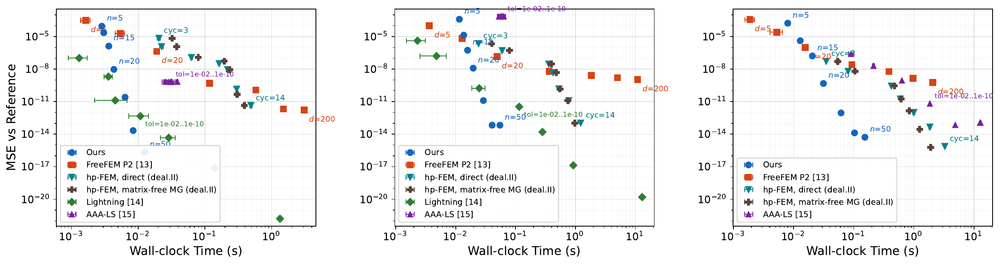
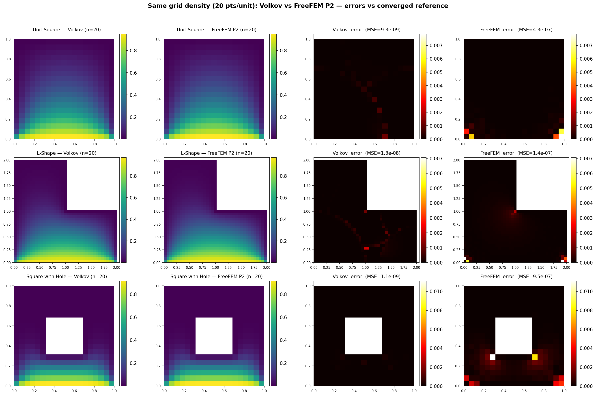
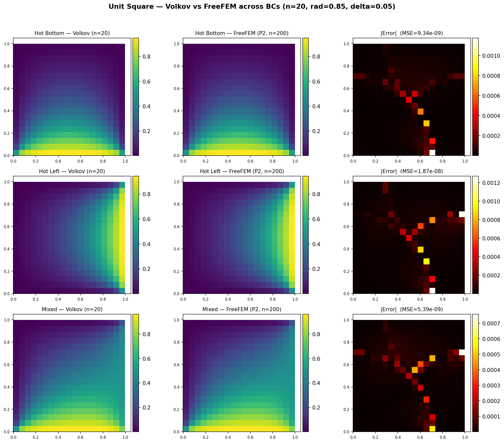
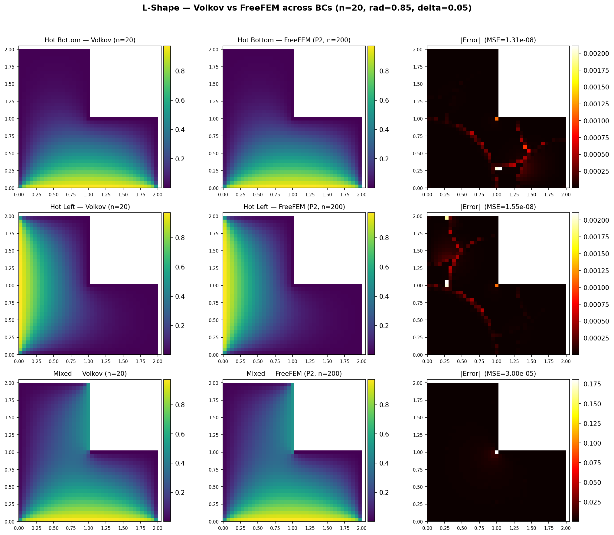
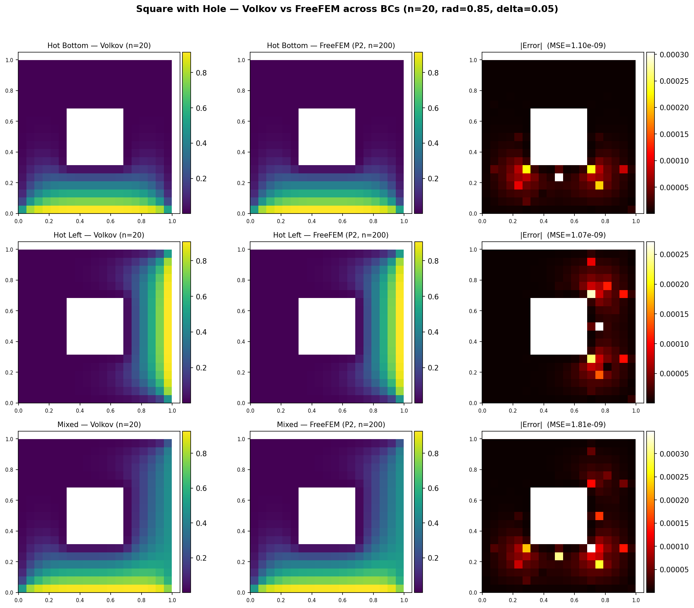

# pyBlockGrid

A high-accuracy Laplace equation solver for arbitrary polygonal domains (including holes and mixed Dirichlet/Neumann boundaries) built on Volkov's Block Method. It converges **exponentially** in its angular parameter — for polynomial boundary data — independently of grid spacing.

In like-for-like benchmarks (every solver compiled to C++, run on the same machine, timed end-to-end, and graded against **independently validated** references), the Block Method holds the best time–accuracy trade-off at high accuracy. Its speedup over a properly configured **hp-adaptive FEM** ([deal.II](https://www.dealii.org/)) *grows with the target accuracy* — up to **~85×** on the smooth unit square and into the tens on the singular L-shape and multiply-connected square-with-hole — reaches **>100×** over low-order [FreeFEM](https://freefem.org/) P2, and stays **competitive** with the [Lightning](https://doi.org/10.1137/19M125947X) and [AAA-LS](https://doi.org/10.4171/8ECM/16) rational-approximation solvers.

## Setup

Requires Python >= 3.9 and NumPy >= 2.0.

```bash
python -m venv venv
source venv/bin/activate
pip install -e .
```

### Building the C++ Backend (Optional)

The solver includes an optional C++ backend (Eigen + pybind11) that is **800-2000x faster** than the pure-Python implementation. If the C++ module is not built, the package uses pure Python automatically.

Prerequisites: `libeigen3-dev` (system package) and `pybind11` (`pip install pybind11`).

```bash
source venv/bin/activate
pip install pybind11
mkdir -p cpp/build && cd cpp/build
cmake .. -DCMAKE_BUILD_TYPE=Release -DPYTHON_EXECUTABLE=$(which python)
make -j$(nproc)
cp _pyblockgrid_cpp*.so ../../src/pyBlockGrid/
```

## Running Tests

```bash
source venv/bin/activate
pip install -r requirements-test.txt
pytest tests/
```

The suite (139 tests) covers golden baseline accuracy, FreeFEM benchmark cross-checks, and Neumann / mixed boundary-condition accuracy (`tests/test_neumann.py`, including the Motz coefficient).

## Performance

All comparisons below are **like-for-like**: every method is compiled to C++, run on the same machine, and timed **end-to-end** (the Block Method's block-covering generation + solve, versus mesh generation + adaptation + assembly + solve for the finite-element methods, and pole placement + least-squares setup for the rational solvers). To avoid grading a method against a fine copy of itself, each reference solution is analytical or independently cross-validated by a second, unrelated method:

| Geometry | Reference | Independence |
|---|---|---|
| unit square | exact Fourier-series solution | analytical (closed form) |
| L-shape | Lightning rational-approximation solution | non-FEM; cross-validated against deal.II hp-FEM (agree to RMSE ≈ 4e-9) |
| square with hole | converged deal.II hp-FEM solution | cross-validated against a converged Block-Method solve (agree to RMSE ≈ 2e-9) |

### Pareto frontier: Block Method vs hp-FEM, FreeFEM P2, Lightning, AAA-LS



End-to-end wall-clock time vs. MSE for all six methods on the three geometries; the hp-adaptive FEM appears twice, with a sparse-direct (UMFPACK) solve and as a matrix-free method with a multigrid-preconditioned conjugate-gradient solve, which reach the same accuracy (left: unit square; middle: L-shape; right: square-with-hole). The Block Method occupies the lower-left frontier at high accuracy. Because it converges exponentially where the finite-element methods converge algebraically, its lead over them **widens as the accuracy target tightens**. Lightning is competitive on smooth data but restricted to simply-connected domains (absent from the right panel); AAA-LS saturates near MSE ~10⁻³ on the L-shape because of the corner jumps in the piecewise-constant data.

### Growing advantage over hp-adaptive FEM

On the singular L-shape, the Block Method's speedup over the hp-adaptive FEM at matched accuracy grows with the accuracy target (representative run; the *ratios* and the growing trend are the reproducible quantities — absolute timings are CPU-dependent):

| Target RMSE | Full pipeline | Solve only |
|---|---|---|
| 1e-4 | 12.1× | 2.9× |
| 1e-5 | 15.4× | 6.5× |
| 1e-6 | 16.6× | 10.3× |

The advantage is larger under full-pipeline accounting because hp-adaptivity's error-estimation and mesh-adaptation cost is substantial. On the smooth unit square the margin over hp-FEM reaches **~57–72×** at the tightest tolerances, depending on the hp-FEM configuration. The matrix-free multigrid hp-FEM (p-multigrid with an algebraic-multigrid coarse solve, 5–22 CG iterations at every size, no matrix assembly) is up to 42% faster than the direct-solver hp-FEM on the largest problems; against the faster hp-FEM variant the Block Method is ~57×, ~25× and ~13× faster on the three geometries at the tightest matched accuracy. All hp-FEM runs are single-threaded, like the other solvers.

### Matched-grid comparison vs low-order FreeFEM P2

On the **same 20 pts/unit grid** (δ=0.05), the Block Method is both faster and more accurate than FreeFEM P2:

| Geometry | C++ Block Method | FreeFEM P2 | Speedup | Block MSE | FreeFEM MSE |
|---|---|---|---|---|---|
| unit_square | **0.3 ms** | 24 ms | **80×** | **9.3e-09** | 4.3e-07 |
| l_shape | **1.2 ms** | 69 ms | **58×** | **1.3e-08** | 1.4e-07 |
| square_with_hole | **0.9 ms** | 19 ms | **21×** | **1.1e-09** | 9.5e-07 |

**Why the accuracy gap?** For P2 elements, FEM theory gives an L2 error of O(h³), i.e. MSE ~ h⁶ ~ 10⁻⁷ at 20 pts/unit — matching the FreeFEM column. To reach Block-Method accuracy (MSE ~ 10⁻⁹) it would need h ~ 0.003 (**~300 pts/unit**, ~225× more elements). The Block Method's accuracy is instead set by its angular parameter `n`, giving grid-independent exponential convergence.



<details>
<summary>Per-geometry solution plots (Block Method vs converged FreeFEM)</summary>

**Unit Square** — hot_bottom, hot_right, mixed:



**L-Shape** — hot_bottom, hot_left, mixed:



**Square with Hole** — hot_bottom, hot_right, mixed:



</details>

## Validation and robustness experiments

Each script is self-contained and writes a PDF into `benchmarks/results/`:

```bash
# Full Pareto comparison (hp-FEM, FreeFEM P2, Lightning, AAA-LS) on all geometries
python benchmarks/benchmark_pareto.py

# Re-entrant-corner robustness: Block Method vs hp-FEM on the L-shape's 270° corner,
# including convergence of the flux-intensity factor c1 -> 0.524.
python benchmarks/robustness_lshape.py

# Motz's problem (mixed Dirichlet-Neumann): the leading singular coefficient
# converges to the standard benchmark value a0 = 401.1625.
python benchmarks/motz.py

# Near-edge external singularity: boundary-data Taylor degree as a precision knob,
# and the accuracy floor as the singularity approaches an edge.
python benchmarks/boundary_singularity.py
```

What they establish:

- **Robust at singular corners.** On the L-shape's 270° re-entrant corner (unbounded ~r⁻¹ᐟ³ gradient), the Block Method reaches RMSE 1.2e-7 in ~0.1 s, while the hp-FEM needs ~2.6×10⁴ DOFs and ~1.9 s for comparable accuracy. The leading flux-intensity factor converges to c₁ = 0.524 (within 6e-8). The r²ᐟ³ corner mode is reproduced analytically by a first-kind block, so the singularity is resolved by construction, not by mesh refinement.
- **Mixed boundary conditions.** Motz's problem (abrupt Dirichlet→Neumann switch) converges to a₀ = 401.1625, matching the accepted benchmark; the field respects the maximum principle. Neumann and mixed Dirichlet–Neumann data (homogeneous and prescribed non-zero flux) are handled to ~10⁻⁸.
- **Boundary-data precision and its limit.** For smooth non-polynomial data the per-edge Taylor degree acts as a precision knob (error → ~10⁻⁸). As a singularity approaches an edge, the required degree grows and the fit becomes ill-conditioned (floor ~10⁻² at d=0.05) — the regime where hp-FEM or boundary-integral methods are the better tool.
- **Multiply-connected domains.** Holes are covered with the same block machinery as the outer boundary (see `examples/multiple_holes_test.py`), with no special treatment.

## Reproducing the full comparison

See **[REPRODUCE.md](REPRODUCE.md)** for a one-command Docker path and a native (Ubuntu) build that compiles both C++ solvers, runs the test suite, and prints the comparison tables and per-target speedups. All references are committed to the repository, so **MATLAB is not required**.

## License

pyBlockMethod is made available under the Rutgers Non-commercial Research License (RU-NCRL, Rutgers Docket # 2024-099) for academic, research, experimental and personal use only; commercial use is not permitted. See **[LICENSE.md](LICENSE.md)** for the full terms (the official version is [LICENSE_RU-NCRL_2024-099.docx](LICENSE_RU-NCRL_2024-099.docx)). For commercial licensing, contact Rutgers Technology Transfer at compliance@research.rutgers.edu.

© 2026, Rutgers, The State University of New Jersey, All rights reserved. Do not copy or reproduce without permission.
